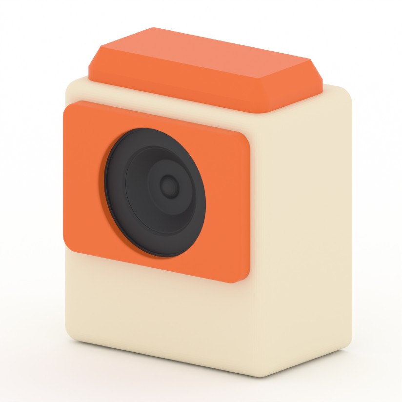

# Learned Duck

**致敬强化学习 Microduck 的桌面蓝牙音箱**

《计算机辅助工业设计》课程作业

 

## 许可

完整条款见 [`LICENSE`](LICENSE)（硬件）与 [`LICENSE-CODE`](LICENSE-CODE)（固件）。

| 部分 | 许可 |
|---|---|
| 硬件设计（CAD、图纸、文档） | CC BY-NC-SA 4.0 |
| 固件代码 | MIT |
