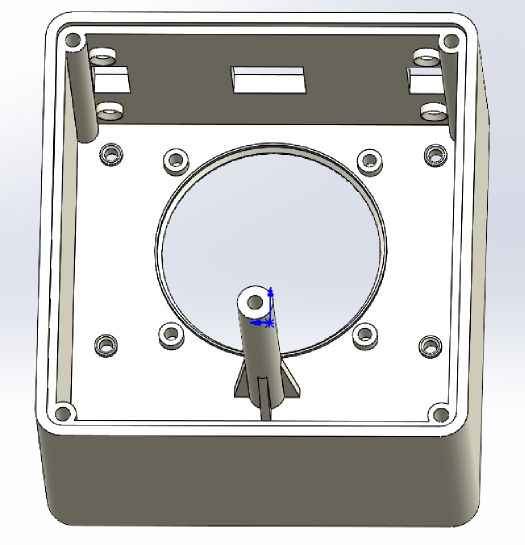
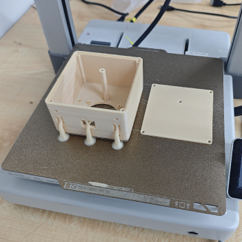
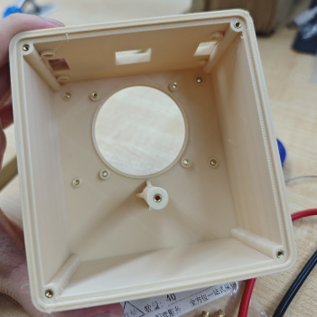
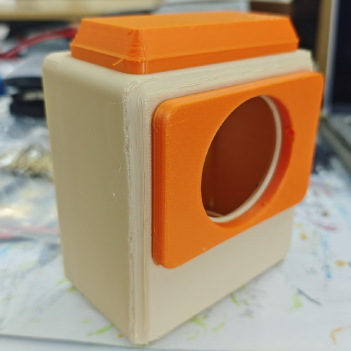
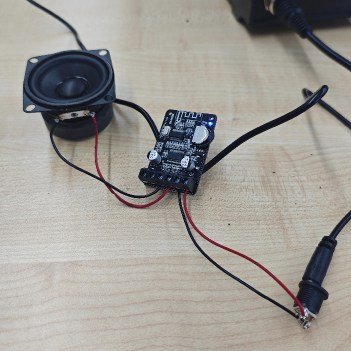

# Learned Duck

**致敬强化学习 Microduck 的桌面蓝牙音箱**

《计算机辅助工业设计》课程作业

## Background

桌面音箱不在「会学习的机器」这场对话里。它们一直是模具压出来的壳，里面装一只喇叭。

> Desktop speakers never entered the conversation about machines that learn.
> They are moulded shells with a driver inside.

## Definition

动手之前，先给方案划下七个约束：

`电源` · `蓝牙` · `出声` · `摆放稳定` · `桌面尺度` · `情感` · `可拆装`

## Idea

从箱体开始推演形体。喇叭放在正面还是侧面、出音口开多大、定位孔落在哪.

## Making

**结构与外观设计 → 3D 打印 → 螺母嵌入 → 结构组装 → 电路连接**。

<table>
<tr>
<td align="center" width="20%"> 结构与外观设计</td>
<td align="center" width="20%"> 3D 打印</td>
<td align="center" width="20%"> 螺母嵌入</td>
<td align="center" width="20%"> 结构组装</td>
<td align="center" width="20%"> 电路连接</td>
</tr>
</table>

SolidWorks 模型在 `cad/智能音箱1108/`：前壳、后盖、头盖、遮罩、喇叭、功放板，以及装配体成品。

## 关于

- **课程**：《计算机辅助工业设计》课程作业记录
- **致敬**：Microduck —— 一台步态由强化学习训练出来的桌面机器人

## 许可

完整条款见 [`LICENSE`](LICENSE)（硬件）与 [`LICENSE-CODE`](LICENSE-CODE)（固件）。

| 部分 | 许可 |
|---|---|
| 硬件设计（CAD、图纸、文档） | CC BY-NC-SA 4.0 |
| 固件代码 | MIT |
